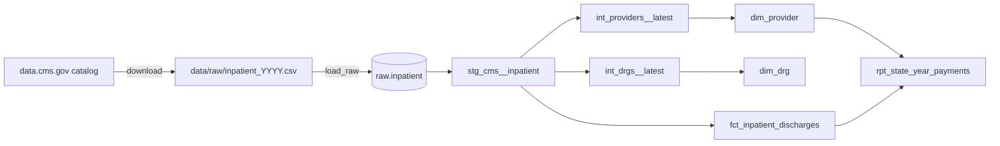

# Medicare inpatient warehouse

A data warehouse built from the public files where Medicare reports what it paid each U.S. hospital for each type of inpatient stay. An Airflow DAG downloads every published year, loads the files into DuckDB, and runs a dbt project that turns them into a star schema with tests on every table.

It answers questions like "what did Medicare pay per hospital stay in Massachusetts each year" with one query against a small reporting table, without touching the 12 raw files.

## What is in it

| | |
|---|---|
| Source | [Medicare Inpatient Hospitals by Provider and Service](https://data.cms.gov/provider-summary-by-type-of-service/medicare-inpatient-hospitals/medicare-inpatient-hospitals-by-provider-and-service), data.cms.gov |
| Years | 2013 to 2024, one CSV per year |
| Rows | 2,131,132 (one per hospital, DRG and year) |
| Hospitals | 3,507 |
| DRGs | 702 |
| dbt tests | 35, all passing on the full data |
| Full run | about 15 seconds on a laptop once the files are downloaded |

A DRG (Diagnosis Related Group) is the code Medicare pays by, for example 470 for a major hip or knee replacement.

## How it works



1. **Download** (`ingest/download.py`). Reads the CMS catalog, finds every year of the dataset and downloads the years that are not on disk yet. When CMS publishes a new year, the next run picks it up with no code change. The 2023 file is Windows-1252 while the others are UTF-8, so every file is converted to UTF-8 on the way in.
2. **Load** (`ingest/load_raw.py`). Stacks the yearly files into one table, `raw.inpatient`, with every column kept as text and the year taken from the file name. Nothing is cleaned here, so the raw table always matches the source.
3. **Transform** (dbt, `models/`).
   - `staging` renames the CMS column names (`Rndrng_Prvdr_CCN` becomes `provider_ccn`) and casts numbers.
   - `intermediate` picks one row per hospital and one per DRG. 1,352 hospitals appear under more than one name between 2013 and 2024, so the dimension keeps the most recent name and address.
   - `marts` holds the star schema: `fct_inpatient_discharges` joined to `dim_provider` and `dim_drg` on hashed surrogate keys, plus `rpt_state_year_payments` for dashboards.
4. **Orchestrate** (`dags/medicare_warehouse.py`). An Airflow DAG runs the three steps in order once a month.

### The fact table is incremental

`fct_inpatient_discharges` only processes years newer than the latest year it already holds. A new year costs one year of work (about 146,000 rows) instead of a rebuild of all 2.1 million.

### Tests and contracts

- Keys are unique and not null on every table, and every fact row must match a hospital and a DRG (referential integrity).
- The grain is tested: hospital, DRG and year are unique together.
- Two checks come from how CMS publishes the data: no row has fewer than 11 discharges (CMS withholds smaller counts for privacy), and Medicare's payment is never more than the total payment.
- `dbt_tests/fact_has_every_staged_row.sql` fails if an incremental run ever drops a row.
- Every mart has an enforced dbt contract, so a changed column name or type fails the build instead of reaching a dashboard.

GitHub Actions runs all of it on every push against a two-state sample in `sample/`. It builds 2022 first and then adds 2023, which exercises the incremental path.

## Run it

Needs [devenv](https://devenv.sh), which pins Python, dbt, DuckDB and Airflow.

```sh
devenv shell
airflow db migrate
airflow dags test medicare_warehouse     # download, load, dbt build
```

The first run downloads about 550 MB. Then query the warehouse:

```sh
python -m ingest.query "select * from rpt_state_year_payments where state_code = 'MA' order by data_year"
```

Or run the steps by hand:

```sh
python -m ingest.download
python -m ingest.load_raw
dbt deps && dbt build
dbt docs generate && dbt docs serve      # lineage graph and column docs
```

`scripts/ci.sh` runs the unit tests and the two-step incremental build on the sample.

## Example result

Medicare payments for inpatient stays in Massachusetts, from `rpt_state_year_payments`:

| Year | Hospitals | Discharges | Medicare paid | Per discharge |
|---|---|---|---|---|
| 2022 | 54 | 179,590 | $2.99 billion | $16,644 |
| 2023 | 54 | 183,445 | $3.02 billion | $16,458 |
| 2024 | 54 | 183,218 | $3.08 billion | $16,808 |

## Layout

```
ingest/       download, load and query scripts
models/       dbt models: staging, intermediate, marts
dbt_tests/    singular dbt tests
dags/         Airflow DAG
tests/        pytest for the ingest code and the DAG
sample/       two states, two years, used by CI
```

## Next

- Add a Snowflake target beside DuckDB so the same models run on a cloud warehouse.
